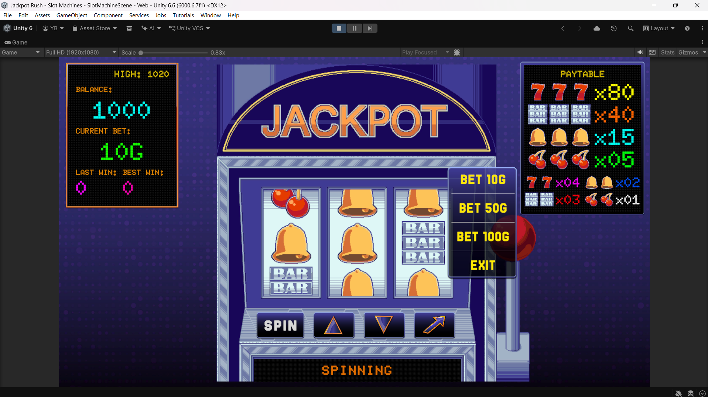
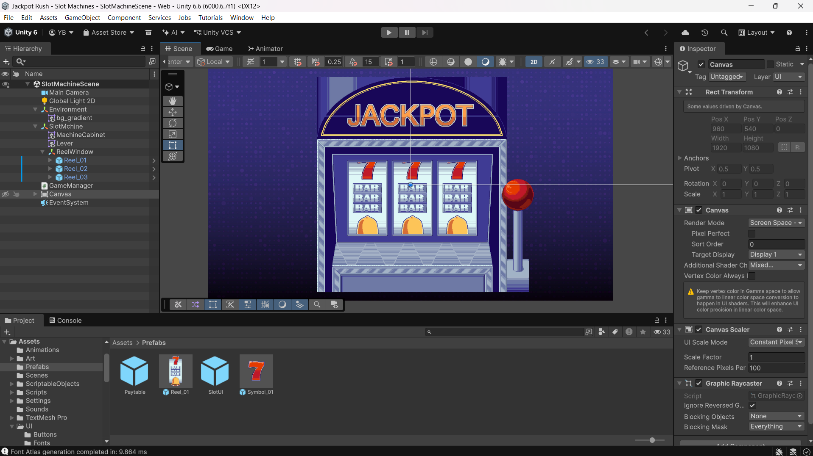
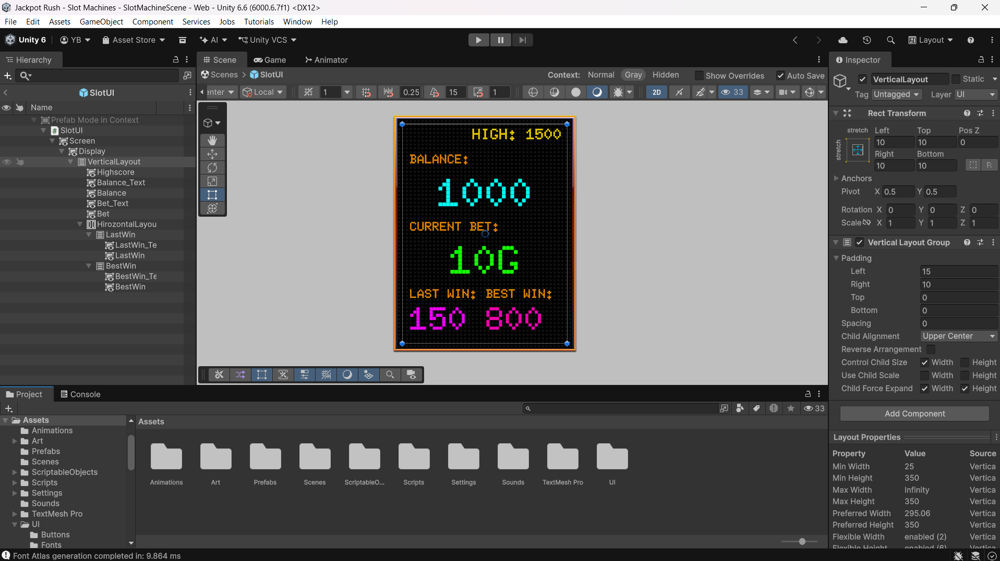
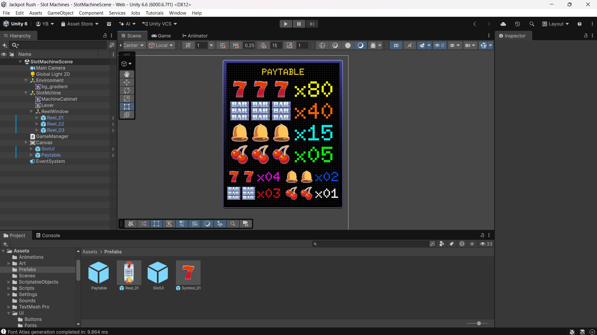

# 🎰 Jackpot Rush – Slot Machines

<p align="center">
  <strong>A retro-inspired slot machine game built with Unity and C#.</strong>
  <br/>
  Designed around modular gameplay systems, event-driven communication, and a classic casino-inspired experience.
</p>

---

## 🎮 Gameplay Showcase

<!-- Replace the URL below with your full gameplay video link -->

<p align="center">
  <a href="YOUR_GAMEPLAY_VIDEO_URL">
    
  </a>
  <br/>
  <em>Click the preview to watch the full gameplay video.</em>
</p>

---

## 📌 About the Project

**Jackpot Rush** is a 2D slot machine game developed using Unity and C#. The project focuses on recreating the experience of a traditional slot machine with a retro pixel-art visual style, animated reels, betting mechanics, symbol-based payouts, and interactive cabinet controls.

The goal was not just to build a working slot machine, but also to structure the project using maintainable and reusable gameplay systems.

### Key Features

- Three animated reels with randomly generated outcomes.
- Four symbols: Seven, BAR, Bell, and Cherry.
- Pair and triple matching combinations.
- Configurable symbol probabilities through a Symbol Database.
- Paytable-based payout calculations.
- Custom bet selection: 10G, 50G, and 100G.
- Balance, current bet, last win, best win, and high balance tracking.
- Persistent high balance using PlayerPrefs.
- Interactive cabinet lever and world-space controls.
- Menu panel for selecting betting amounts.
- Event-driven UI communication using ScriptableObject event channels.
- Audio feedback for spins, wins, losses, errors, and button interactions.
- Retro-inspired pixel-art interface and animated CRT-style message display.

---

## 🛠️ Tech Stack

| Technology | Usage |
|---|---|
| Unity 6 | Game development |
| C# | Gameplay programming |
| Unity UI | Interactive UI elements |
| TextMeshPro | Text rendering |
| ScriptableObjects | Game data and event channels |
| Animator | Lever animation |
| PlayerPrefs | High balance persistence |
| Git & GitHub | Version control |

---

## 🚀 Development Journey

The project was developed incrementally, starting with the core gameplay concept and gradually integrating the gameplay systems, UI, and visual presentation.

### 1. Planning the Core Gameplay

The initial focus was defining the rules and essential mechanics of a traditional three-reel slot machine.

The main gameplay requirements were:

- Three reels, each displaying three visible symbols.
- Random symbol generation for every spin.
- Winning combinations determined by matching symbols in the center positions.
- Two matching symbols result in a pair payout.
- Three matching symbols result in a triple payout.
- Betting amounts determine the final payout.

The paytable was defined before implementing the payout logic.

### 2. Building the Slot Machine

The next stage involved assembling the main slot machine environment in Unity.

This included:
- Creating the cabinet and its visual structure.
- Setting up three independent reel GameObjects.
- Creating the visible symbol positions for each reel.
- Integrating the lever and its Animator.
- Organizing the scene hierarchy into separate gameplay and UI objects.



### 3. Implementing the Gameplay Systems

The gameplay logic was separated into smaller responsibilities rather than placing everything inside one large manager.

The primary systems include:

- **SlotGameManager:** Coordinates the overall spin process and gameplay flow.
- **ReelController:** Handles the animation and final symbol display of an individual reel.
- **SpinResultGenerator:** Generates random outcomes using the configured symbol distribution.
- **WinEvaluator:** Determines whether the result contains a winning combination.
- **PayoutCalculator:** Calculates the payout using the bet amount and paytable.
- **WalletManager:** Manages the player's balance and high balance.

This separation makes individual systems easier to maintain and modify.

### 4. Designing the Game Architecture

As the number of gameplay and UI systems increased, communication between components needed to remain organized.

ScriptableObject-based event channels were introduced to decouple the UI from gameplay logic.

The UI raises events for player input, while gameplay systems publish events when values or game states change.

This avoids unnecessary direct references between UI components and gameplay managers.

<details>
<summary><strong>View the interactive architecture diagram</strong></summary>

[Open the complete architecture diagram in Mermaid Live](https://mermaid.live/)

The architecture diagram shows the main GameObjects, their attached components, game data, and event-channel communication.

</details>

<iframe src="https://mermaid.live/embed?theme=redux-color&look=classic&mode=light&controls=0#pako:eNqNVY1u2zYQfhVCQYEOU9bF9prOGArIsuAJkGIjlhdkVTHQ0skmQpOeSGUN2j7HHqgvVv5IbkIp3QwY8B3vu5-P39EfvYKX4E29ivJ_ij2uJcpmeZ0z_UXqI5rtrsbHPVoEabRKgtt3ubfABzhS_JB777sw_Vmk7VmKGd5B_du2fvV2Tbl85EMv14TtKEjOfrDnR8KuQTRULoBBjSWvnbQ3QZJEmUp9g6kCGpT92eZ04q-jKFmr8GsAKkz0GH35F2kz5EzWXEFdTBjM4itTJMRbwtoqCdxD_Q2DfkQBI4eBFoPNPF4qcNCUhD-e3jjWvKkLeAQBVg5SvIlVjk3sJF8ny8ycaCpVzInWTfzsPGl0tVGIFFiDVpgBNSBtGutZ3Dxet3ecpSs0J0JfsyVRGQXP4IMc4OC5gaI_oqtM30V0D0yicI-Zqi6covHVaqOpj8K_rBr-bkBIKE1Z5ZyB1MgdDJ2sgUIhCf8Gc7IvN9kp_QxTzAqw2fr5T54EC3lDWC9uyPs72e2H8-ph1hJL15-CEEohrfd_0DgPsqBdLTTHErsCuU1nSyP59cNhy6kO2WIBVignl4NaBbdZMEsiBVvhB4Wg4EQky0Uc6r0jLLrHtNGXbnKqeN7IENOiod9XwosXqHssUA0V1KBoEt3pIkXn52_twjo-u_SOs91Sx2uWz_GZ1h1fS1PnNSHmoGPCaXwTI8KOjexcdg814pN6XDARahDvk1VvF6P3ro1QqkKiEye6Jxj1d9ZBG6OFJ0RpmZkKi7TfmeL_UWt2widtWdl3AZbOrjOrVvQKae2i1uyDrNXvxxLRp6V7PZxu9aszwM_yCEy1EFIuTG195CDN6-nW-cnO0Ej1F4KWLKSkuNP4JzKwdf4ztAsvKBZiDhXadWKtCKXTs8mv48nlpV9wyuvpWVVVvlB3dwfTM3z5ZlvhHr4hLfLyYlxdjIaQ1XZbjSY9JJgX0oIvXk_g9XgIPBqVY4AeuFTr3WEnv4xH5RB2gkt483NvbCUe38rDN4vot1vmG5ZOjDzF2MvwNc1-e-tq9qcxRs1-KyIznpPD7qPfrZ9vN1LP4vnerialN5V1A753gPqAtel9zD25h4MSzDT3aiibD-dm0tzzc49yfmcOTH5S5N5nleiI2Z-cH7pcNW92e29aYSqU1RxVOZgTrB7aNuTzV9wl4VE" width="100%" height="480" loading="lazy" title="Jackpot Rush architecture diagram" sandbox="allow-scripts allow-same-origin allow-popups allow-popups-to-escape-sandbox"></iframe>

**Architecture highlights:**

- `SlotGameManager` is the central gameplay coordinator and the only Singleton.
- `WalletManager` manages balance and persistent high balance.
- Each reel has its own `ReelController`.
- `SlotUIController` communicates with gameplay through event channels.
- `MenuPanelController` independently manages menu visibility.
- `AudioManager` handles gameplay and UI sound effects.
- `WinEvaluator` and `PayoutCalculator` are separate logic classes.

### 5. Building the UI and Statistics Panel

After the core gameplay systems were in place, the player-facing interface was developed.

The statistics display was designed to show:

- Current balance.
- Highest recorded balance.
- Current bet.
- Last win.
- Best win.

The UI receives updates through event channels rather than directly accessing gameplay components.



### 6. Implementing the Paytable

The paytable defines the reward for each matching symbol combination.

| Symbol | Pair | Triple |
|---|---:|---:|
| Seven | 4x | 80x |
| BAR | 3x | 40x |
| Bell | 2x | 15x |
| Cherry | 1x | 5x |

The payout is calculated using:

```csharp
payout = betAmount * multiplier;
```

The payout calculator uses the configured paytable to determine the correct multiplier based on the winning symbol and match count.



### 7. Integrating Controls, Audio and Persistence

The final integration stage connected the gameplay, UI, cabinet controls, and audio systems.

This included:

- Adding preset betting options through the menu panel.
- Connecting the cabinet controls to their respective actions.
- Adding button-click audio feedback.
- Playing spin, win, loss, and error sounds.
- Persisting the highest balance using PlayerPrefs.
- Adding queued status messages to the CRT-style display.
- Adding animated rainbow text effects to the message display.


---

## 💻 Code Highlights

A few examples of the implementation approach used in the project.

### 1. Event-Driven Communication

The UI requests a spin without directly referencing the game manager.

```csharp
public void OnSpinClicked()
{
    spinRequested?.RaiseEvent();
}
```

The game manager subscribes to the event:

```csharp
private void OnEnable()
{
    if (spinRequested != null)
        spinRequested.OnEventRaised += Spin;
}
```

This keeps input handling separate from gameplay execution.

### 2. Win Evaluation

The win evaluator checks for triple matches first, followed by pair matches.

```csharp
if (first == second && second == third)
{
    winningSymbol = first;
    matchCount = 3;
    return true;
}

if (first == second)
    winningSymbol = first;
else if (first == third)
    winningSymbol = first;
else if (second == third)
    winningSymbol = second;
```

Checking triples first ensures that a triple match is not incorrectly evaluated as a pair.

### 3. Persistent High Balance

The high balance is loaded from PlayerPrefs and updated whenever the player's balance exceeds the previous record.

```csharp
if (Balance > HighBalance)
{
    HighBalance = Balance;

    PlayerPrefs.SetInt(HighBalanceKey, HighBalance);
    PlayerPrefs.Save();

    highBalanceChanged?.RaiseEvent(HighBalance);
}
```

This preserves the highest recorded balance across normal game sessions on the same browser/device storage.

### 4. Playing Button Sounds

Button interactions use `PlayOneShot()` so that UI sounds do not interrupt other audio playback.

```csharp
public void PlayButtonClick()
{
    if (buttonClickSFX != null)
        audioSource.PlayOneShot(buttonClickSFX);
}
```

---

## 🧠 Key Technical Decisions

| Decision | Reason |
|---|---|
| Single central Singleton | Keeps global gameplay coordination straightforward |
| Separate reel controllers | Each reel manages its own animation |
| ScriptableObject event channels | Reduces direct dependencies between UI and gameplay |
| Separate win and payout logic | Keeps evaluation and reward calculation independent |
| Weighted symbol selection | Allows configurable symbol probabilities |
| PlayerPrefs for high balance | Provides simple local persistence |
| Separate menu controller | Keeps menu visibility independent of gameplay UI logic |

---

## 📂 Project Structure

```text
Assets/
├── Animations/
├── Art/
├── Prefabs/
├── Scenes/
├── ScriptableObjects/
├── Scripts/
│   ├── Audio/
│   ├── Gameplay/
│   ├── Reels/
│   ├── UI/
│   └── Utilities/
├── Settings/
├── Sounds/
└── UI/

docs/
└── images/
    ├── 01-slot-machine-scene.png
    ├── 02-statistics-panel.png
    ├── 03-paytable-design.png
    └── 04-final-gameplay.png
```

*The script subfolder names above are illustrative; adjust them to match the actual repository.*

---

## ⚙️ Getting Started

### Requirements

- Unity 6
- Git

### Setup

1. Clone this repository:

   ```bash
   git clone YOUR_REPOSITORY_URL
   ```

2. Open Unity Hub.
3. Select **Add Project from Disk**.
4. Choose the cloned project directory.
5. Open the project using the compatible Unity version.
6. Open `Assets/Scenes/SlotMachineScene.unity`.
7. Press Play to run the game.

---

## 🔮 Possible Future Improvements

- Additional symbols and configurable paytable combinations.
- More detailed spin and reel-stop animations.
- Improved visual feedback for winning combinations.
- Additional gameplay modes.
- Improved audio and visual effects.

---

## 👨‍💻 Developer

**Yash Bhavsar**

Game Developer | Unity & C#

- Portfolio: https://yashbhavsar.in
- GitHub: https://github.com/YashBhavsar29/

---

<p align="center">
  <strong>Built with Unity, C#, and a lot of spins. 🎰</strong>
</p>