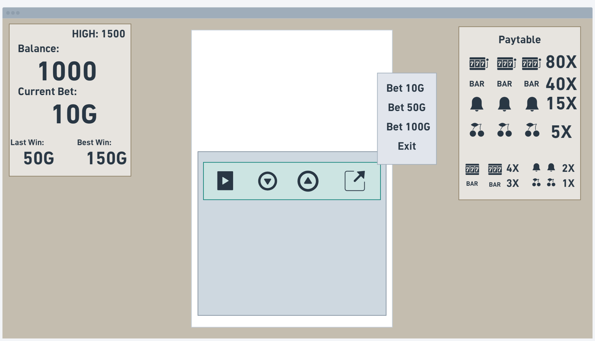
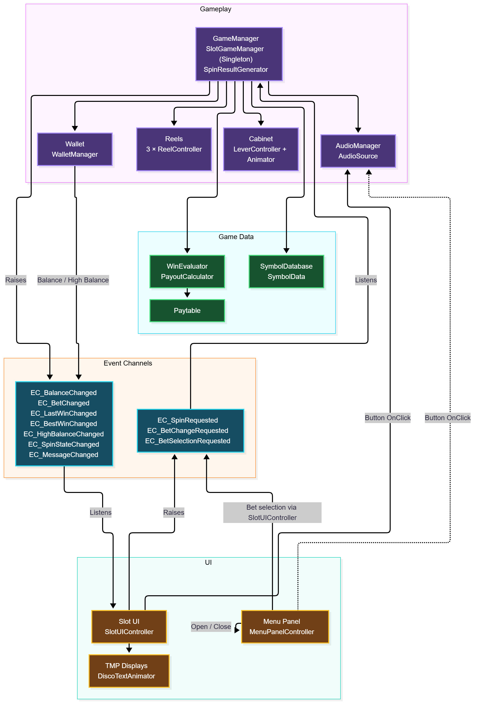

# 🎰 Jackpot Rush – Slot Machines

<p align="center">
  <strong>A retro-inspired slot machine game built with Unity and C#.</strong>
  <br/>
  Featuring animated reels, betting mechanics, symbol-based payouts, and an event-driven architecture.
</p>

<p align="center">
  <a href="https://play.unity.com/en/games/c9e28b48-17f2-4825-bd8b-9a24df0d78a8/web">
    
  </a>
  <a href="https://youtu.be/wa_QWqaYWis">
    
  </a>
</p>

---

## 🎮 Gameplay Showcase

<p align="center">
  <a href="https://youtu.be/wa_QWqaYWis">
    
  </a>
  <br/>
  <em>Watch the complete gameplay demonstration.</em>
</p>

<p align="center">
  <a href="https://play.unity.com/en/games/c9e28b48-17f2-4825-bd8b-9a24df0d78a8/web">
    <strong>▶ PLAY JACKPOT RUSH ONLINE</strong>
  </a>
</p>

**The game is published on Unity Play and can be played directly in your browser without downloading the Unity project.**

---

## 🎯 Project Context

This project was developed as part of the submission for **Underpin Services' Unity Development Intern hiring process**.

The assignment provided an opportunity to demonstrate practical Unity development skills, including gameplay programming, system architecture, UI implementation, animation, audio integration, and building a complete playable WebGL experience.

The project was developed with an emphasis on clean code, modular systems, and maintainable architecture.

## 📌 About the Project

Jackpot Rush is a 2D slot machine game developed using Unity and C#. Inspired by traditional casino slot machines, the game combines a retro pixel-art visual style with interactive controls, animated reels, betting mechanics, and symbol-based payouts.

The project was developed with a focus on both gameplay functionality and maintainable software architecture. Individual systems handle reel animations, result generation, win evaluation, payout calculation, wallet management, audio, and UI communication.

### Key Features

- Three animated reels with three visible symbols each.
- Four symbols: Seven, BAR, Bell, and Cherry.
- Pair and triple matching combinations.
- Weighted random symbol generation.
- Configurable paytable-based payouts.
- Custom bet selection: 10G, 50G, and 100G.
- Balance, last win, best win, and high balance tracking.
- Persistent high balance using PlayerPrefs.
- Interactive cabinet lever and world-space controls.
- Menu panel for betting options.
- ScriptableObject-based event-driven communication.
- Gameplay and UI sound effects.
- Retro-inspired pixel-art interface.
- Animated CRT-style message display.

---

## 🛠️ Tech Stack

| Technology | Usage |
|---|---|
| Unity 6 | Game development |
| C# | Gameplay programming |
| Unity UI | Interactive UI |
| TextMeshPro | Text rendering |
| ScriptableObjects | Game data and event channels |
| Animator | Lever animation |
| PlayerPrefs | Local high balance persistence |
| Git & GitHub | Version control |

---

## 🚀 Development Journey

The project was developed incrementally, starting with the core gameplay concept and progressing toward a complete playable experience.

### Initial UI Planning & Concept

Before starting the implementation, I created an initial UI concept to define the overall layout and interaction flow of the slot machine.

The mockup established the placement of the three main areas:

- **Statistics Panel:** Displays the player's balance, current bet, last win, and best win.
- **Slot Machine Interface:** Contains the reels, primary spin control, and interactive cabinet buttons.
- **Paytable Panel:** Displays the winning symbol combinations and their respective multipliers.

The concept also included a dedicated menu for selecting betting amounts and accessing additional controls.

This initial design served as a visual reference throughout development. The final implementation evolved from this layout while retaining its core structure and functionality.



### 1. Planning the Core Gameplay

The first step was defining the rules and essential mechanics of a traditional three-reel slot machine.

The core requirements included:

- Three reels, each displaying three visible symbols.
- Random symbol generation for every spin.
- Winning combinations determined by matching symbols in the center positions.
- Two matching symbols result in a pair payout.
- Three matching symbols result in a triple payout.
- Betting amounts determine the final payout.

The paytable and gameplay rules were established before implementing the payout logic.

### 2. Building the Slot Machine

The next stage involved assembling the slot machine environment in Unity.

This included:
- Creating the cabinet and its visual structure.
- Setting up three independent reel GameObjects.
- Creating the visible symbol positions for each reel.
- Integrating the lever and its Animator.
- Organizing the scene hierarchy into separate gameplay and UI objects.


### 3. Implementing Gameplay Systems

The gameplay logic was divided into smaller responsibilities rather than placing everything inside one large manager.

| Component | Responsibility |
|---|---|
| SlotGameManager | Coordinates the overall gameplay and spin process |
| ReelController | Handles individual reel animations and final symbols |
| SpinResultGenerator | Generates random outcomes using symbol probabilities |
| WinEvaluator | Identifies pair and triple matches |
| PayoutCalculator | Calculates rewards using the paytable |
| WalletManager | Manages player balance and high balance |
| AudioManager | Handles gameplay and UI sound effects |

### 4. Designing the Game Architecture

As the number of gameplay and UI systems increased, communication between components needed to remain organized.

ScriptableObject-based event channels were introduced to decouple the UI from gameplay logic.

The UI raises events for player input, while gameplay systems publish events whenever values or game states change.

This avoids unnecessary direct references between UI components and gameplay managers.



**Architecture highlights:**

- `SlotGameManager` acts as the central gameplay coordinator and the only Singleton.
- `WalletManager` manages balance and persistent high balance.
- Each reel has its own `ReelController`.
- `SlotUIController` communicates with gameplay through event channels.
- `MenuPanelController` independently manages menu visibility.
- `AudioManager` handles gameplay and UI sound effects.
- `WinEvaluator` and `PayoutCalculator` are separate logic classes.

### 5. Designing the UI and Statistics Panel

After the core gameplay systems were in place, the player-facing interface was developed.

The statistics display was designed to show:

- Current balance.
- Highest recorded balance.
- Current bet.
- Last win.
- Best win.

The UI receives updates through event channels rather than directly accessing gameplay components.


### 6. Implementing the Paytable

The paytable defines the reward for each matching symbol combination.

| Symbol | Pair | Triple |
|---|---:|---:|
| Seven | 4x | 80x |
| BAR | 3x | 40x |
| Bell | 2x | 15x |
| Cherry | 1x | 5x |

The payout is calculated using:

```csharp
payout = betAmount * multiplier;
```

The payout calculator uses the configured paytable to determine the correct multiplier based on the winning symbol and match count.


### 7. Integrating Controls, Audio and Persistence

The final integration stage connected gameplay, UI, cabinet controls, and audio systems.

This included:

- Adding preset betting options through the menu panel.
- Connecting cabinet controls to their respective actions.
- Adding button-click audio feedback.
- Playing spin, win, loss, and error sounds.
- Persisting the highest balance using PlayerPrefs.
- Adding queued status messages to the CRT-style display.
- Adding animated rainbow text effects to the message display.


### 8. Publishing the WebGL Build

Once the gameplay and UI systems were integrated, the project was exported as a WebGL build.

The exported build was published on Unity Play, making the game accessible directly through a web browser.

**Play the published game:**

[Jackpot Rush – Unity Play](https://play.unity.com/en/games/c9e28b48-17f2-4825-bd8b-9a24df0d78a8/web)

**Watch the gameplay demonstration:**

[Jackpot Rush – YouTube](https://youtu.be/wa_QWqaYWis)

---

## 💻 Code Highlights

### 1. Event-Driven Communication

The UI requests a spin without directly referencing the game manager.

```csharp
public void OnSpinClicked()
{
    spinRequested?.RaiseEvent();
}
```

The game manager subscribes to the event:

```csharp
private void OnEnable()
{
    if (spinRequested != null)
        spinRequested.OnEventRaised += Spin;
}
```

This keeps input handling separate from gameplay execution.

### 2. Win Evaluation

The win evaluator checks for triple matches first, followed by pair matches.

```csharp
if (first == second && second == third)
{
    winningSymbol = first;
    matchCount = 3;
    return true;
}
```

Checking triples first ensures that a triple match is not incorrectly evaluated as a pair.

### 3. Persistent High Balance

The high balance is updated whenever the player's balance exceeds the previous record.

```csharp
if (Balance > HighBalance)
{
    HighBalance = Balance;

    PlayerPrefs.SetInt(HighBalanceKey, HighBalance);
    PlayerPrefs.Save();

    highBalanceChanged?.RaiseEvent(HighBalance);
}
```

This preserves the highest recorded balance across normal sessions on the same browser/device storage.

### 4. Button Sound Effects

Button interactions use `PlayOneShot()` so UI sounds do not interrupt other audio playback.

```csharp
public void PlayButtonClick()
{
    if (buttonClickSFX != null)
        audioSource.PlayOneShot(buttonClickSFX);
}
```

---

## 🧠 Key Technical Decisions

| Decision | Reason |
|---|---|
| Single central Singleton | Keeps global gameplay coordination straightforward |
| Separate reel controllers | Each reel manages its own animation |
| ScriptableObject event channels | Reduces direct dependencies between UI and gameplay |
| Separate win and payout logic | Keeps evaluation and reward calculation independent |
| Weighted symbol selection | Allows configurable symbol probabilities |
| PlayerPrefs for high balance | Provides simple local persistence |
| Separate menu controller | Keeps menu visibility independent of gameplay UI logic |

---

## 📂 Project Structure

```text
Assets/
├── Animations/
├── Art/
├── Prefabs/
├── Scenes/
├── ScriptableObjects/
├── Scripts/
│   ├── Audio/
│   ├── Gameplay/
│   ├── Reels/
│   ├── UI/
│   └── Utilities/
├── Settings/
├── Sounds/
└── UI/

docs/
├── images/
│   ├── 01-slot-machine-scene.png
│   ├── 02-statistics-panel.png
│   ├── 03-paytable-design.png
│   ├── 04-final-gameplay.png
│   └── 05-game-architecture.png
└── videos/
```

*Adjust the folder names to match the actual repository structure.*

---

## ⚙️ Getting Started

### Requirements

- Unity 6
- Git

### Setup

1. Clone the repository:

   ```bash
   git clone https://github.com/YashBhavsar29/JackpotRush-SlotMachines.git
   ```

2. Open Unity Hub.
3. Select **Add Project from Disk**.
4. Choose the cloned project directory.
5. Open the project using the compatible Unity version.
6. Open `Assets/Scenes/SlotMachineScene.unity`.
7. Press Play to run the game.

---

## 🔮 Future Improvements

- Additional symbols and configurable payout combinations.
- More detailed spin and reel-stop animations.
- Improved visual feedback for winning combinations.
- Additional gameplay modes.
- Further audio and visual effects.

---

## 👨‍💻 Developer

**Yash Bhavsar**

Game Developer | Unity & C#

- Portfolio: https://yashbhavsar.in
- GitHub: https://github.com/YashBhavsar29/

---

<p align="center">
  <strong>Built with Unity, C#, and a lot of spins. 🎰</strong>
  <br/>
  <a href="https://play.unity.com/en/games/c9e28b48-17f2-4825-bd8b-9a24df0d78a8/web">Play the Game</a>
  &nbsp;•&nbsp;
  <a href="https://youtu.be/wa_QWqaYWis">Watch Gameplay</a>
</p>